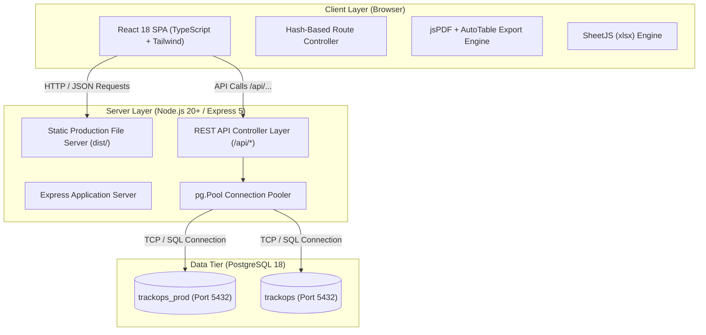
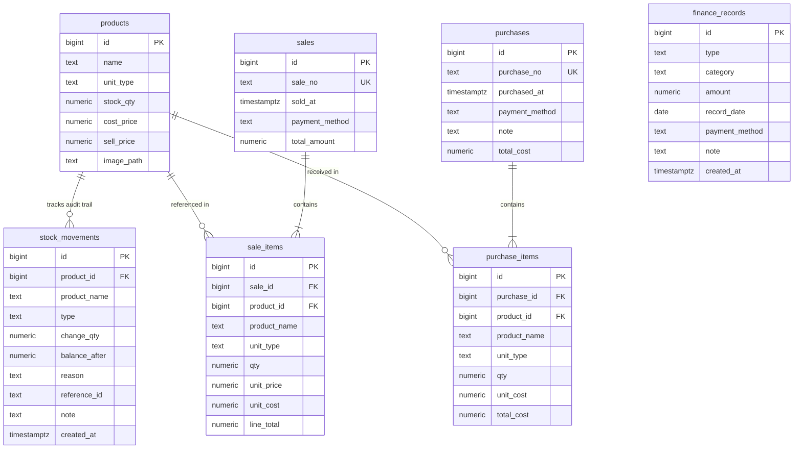

# TrackOps - Application & Database Architecture Specification

**Document ID:** TRK-ARCH-V1.0  
**Application:** TrackOps - Comic Stall Management System  
**Version:** v1.0 Production  
**Target Audience:** Software Engineers, System Architects, DevOps, Technical Leads  

---

## 1. System Topology & Deployment Architecture

TrackOps employs a decoupled, client-server single-node architecture optimized for low-latency offline execution on local machines.



---

## 2. Environment Topology Comparison

| Architecture Feature | UAT Environment | Production (v1.0) Environment |
| :--- | :--- | :--- |
| **Directory** | `E:\trackops` | `E:\trackops-prod` |
| **Client Hosting** | Vite Development Server (`http://localhost:3000`) | Built static bundle served by Express (`dist/`) |
| **API Server** | Express API listening on `http://localhost:4000` | Unified Express server listening on `http://localhost:5000` |
| **Port Forwarding** | Vite proxy redirects `/api` to port `4000` | Same-origin requests direct to port `5000` |
| **Database Instance** | PostgreSQL Database `trackops` on port `5432` | PostgreSQL Database `trackops_prod` on port `5432` |
| **Hot Reload / Watcher** | Active Vite HMR + `tsx` watcher | Zero file watchers, zero dev server overhead |

---

## 3. Frontend Architecture

### 3.1 Technology Stack
- **Framework:** React 18.3.1 (with TypeScript 5.7.2)
- **Bundler:** Vite 6.0.7
- **Styling:** Tailwind CSS 3.4.17 with PostCSS and Autoprefixer
- **Typography & Icons:** Inter (`@fontsource/inter`), Material Symbols Outlined
- **Client Document Engines:** `jspdf` (v2.5.2), `jspdf-autotable` (v3.8.4), `xlsx` (v0.18.5)

### 3.2 Routing Strategy
The application utilizes a **hash-based routing model** (`#/inventory`, `#/sales`, `#/purchases`, `#/finances`).
- **Rationale:** Comic stall POS hardware often runs locally or from file directories without a complex reverse-proxy rewrite ruleset. Hash routing eliminates `404 Not Found` errors when refreshing deep pages.
- **Redirection Logic:** Route `/` and all unrecognized paths automatically redirect to `#/inventory`. The legacy `/reports` route is permanently disabled and redirects to `#/inventory` per Change Request CR-001.

### 3.3 Component Hierarchy
```
App.tsx (Root Shell & Route Evaluator)
├── Header.tsx (Title, Navigation items, Environment & Database indicators)
├── Sidebar.tsx (Desktop & Mobile collapsible navigation menu)
├── Toast.tsx (Global notification dispatcher)
└── Page Views:
    ├── InventoryPage.tsx (Catalogue grid, stock adjustments, low-stock warnings)
    ├── SalesPage.tsx (POS catalog, search, cart computation, Cash/UPI checkout)
    ├── PurchasesPage.tsx (Vendor order entry, quick-add products, receipt generation)
    └── FinancesPage.tsx (KPI strip, P&L statement, variance analysis, unified cashflow registers)
```

---

## 4. Backend Architecture

### 4.1 Framework & Middleware Pipeline
The backend is constructed with **Express 5.3.0** executed through `tsx` / Node.js ESM.


### 4.2 Database Access Layer
Database communication is abstracted through a singleton connection pool in [`server/db.ts`](file:///e:/trackops/server/db.ts):
```typescript
import pg from 'pg';
const { Pool } = pg;
export const pool = new Pool({
  connectionString: process.env.DATABASE_URL
});
```
- **Connection Resilience:** The pool manages connection reuse, idle client timeouts, and automated error listeners.

---

## 5. Database Architecture & ER Diagram

### 5.1 Entity-Relationship (ER) Diagram



---

## 6. Table Definitions & Constraints

### 6.1 `products` Table
Primary product catalogue.
```sql
CREATE TABLE products (
  id          BIGINT GENERATED ALWAYS AS IDENTITY PRIMARY KEY,
  name        TEXT          NOT NULL CHECK (length(btrim(name)) > 0),
  unit_type   TEXT          NOT NULL DEFAULT 'pcs',
  stock_qty   NUMERIC(12,3) NOT NULL DEFAULT 0 CHECK (stock_qty >= 0),
  cost_price  NUMERIC(12,2) NOT NULL DEFAULT 0 CHECK (cost_price >= 0),
  sell_price  NUMERIC(12,2) NOT NULL DEFAULT 0 CHECK (sell_price >= 0),
  image_path  TEXT
);
CREATE UNIQUE INDEX idx_products_name_unit ON products (lower(name), lower(unit_type));
```

### 6.2 `stock_movements` Table
Immutable audit ledger for all inventory adjustments.
```sql
CREATE TABLE stock_movements (
  id            BIGINT GENERATED ALWAYS AS IDENTITY PRIMARY KEY,
  product_id    BIGINT REFERENCES products(id) ON DELETE SET NULL,
  product_name  TEXT NOT NULL,
  type          TEXT NOT NULL, -- 'initial', 'sale', 'purchase', 'adjustment'
  change_qty    NUMERIC(12,3) NOT NULL,
  balance_after NUMERIC(12,3) NOT NULL,
  reason        TEXT,
  reference_id  TEXT,
  note          TEXT,
  created_at    TIMESTAMPTZ NOT NULL DEFAULT NOW()
);
```

### 6.3 `sales` and `sale_items` Tables
Header and line items for POS customer transactions.
```sql
CREATE SEQUENCE IF NOT EXISTS sale_number_seq START WITH 1;

CREATE TABLE sales (
  id             BIGINT GENERATED ALWAYS AS IDENTITY PRIMARY KEY,
  sale_no        TEXT UNIQUE NOT NULL DEFAULT ('S-' || LPAD(nextval('sale_number_seq')::TEXT, 4, '0')),
  sold_at        TIMESTAMPTZ NOT NULL DEFAULT NOW(),
  payment_method TEXT NOT NULL CHECK (payment_method IN ('Cash', 'UPI')),
  total_amount   NUMERIC(12,2) NOT NULL DEFAULT 0 CHECK (total_amount >= 0)
);

CREATE TABLE sale_items (
  id           BIGINT GENERATED ALWAYS AS IDENTITY PRIMARY KEY,
  sale_id      BIGINT NOT NULL REFERENCES sales(id) ON DELETE CASCADE,
  product_id   BIGINT REFERENCES products(id) ON DELETE SET NULL,
  product_name TEXT NOT NULL,
  unit_type    TEXT NOT NULL,
  qty          NUMERIC(12,3) NOT NULL CHECK (qty > 0),
  unit_price   NUMERIC(12,2) NOT NULL CHECK (unit_price >= 0),
  unit_cost    NUMERIC(12,2) NOT NULL CHECK (unit_cost >= 0),
  line_total   NUMERIC(12,2) GENERATED ALWAYS AS (round(qty * unit_price, 2)) STORED
);
```

### 6.4 `purchases` and `purchase_items` Tables
Header and line items for inventory vendor purchases.
```sql
CREATE SEQUENCE IF NOT EXISTS purchase_number_seq START WITH 1;

CREATE TABLE purchases (
  id             BIGINT GENERATED ALWAYS AS IDENTITY PRIMARY KEY,
  purchase_no    TEXT UNIQUE NOT NULL DEFAULT ('P-' || LPAD(nextval('purchase_number_seq')::TEXT, 4, '0')),
  purchased_at   TIMESTAMPTZ NOT NULL DEFAULT NOW(),
  payment_method TEXT NOT NULL CHECK (payment_method IN ('Cash', 'UPI')),
  note           TEXT,
  total_cost     NUMERIC(12,2) NOT NULL DEFAULT 0 CHECK (total_cost >= 0)
);

CREATE TABLE purchase_items (
  id           BIGINT GENERATED ALWAYS AS IDENTITY PRIMARY KEY,
  purchase_id  BIGINT NOT NULL REFERENCES purchases(id) ON DELETE CASCADE,
  product_id   BIGINT REFERENCES products(id) ON DELETE SET NULL,
  product_name TEXT NOT NULL,
  unit_type    TEXT NOT NULL,
  qty          NUMERIC(12,3) NOT NULL CHECK (qty > 0),
  unit_cost    NUMERIC(12,2) NOT NULL CHECK (unit_cost >= 0),
  total_cost   NUMERIC(12,2) GENERATED ALWAYS AS (round(qty * unit_cost, 2)) STORED
);
```

### 6.5 `finance_records` Table
Manual ledger entries for operating expenses and non-sales income.
```sql
CREATE TABLE finance_records (
  id             BIGINT GENERATED ALWAYS AS IDENTITY PRIMARY KEY,
  type           TEXT NOT NULL CHECK (type IN ('income', 'expense')),
  category       TEXT NOT NULL CHECK (trim(category) <> ''),
  amount         NUMERIC(12,2) NOT NULL CHECK (amount > 0),
  record_date    DATE NOT NULL DEFAULT (CURRENT_TIMESTAMP AT TIME ZONE 'Asia/Kolkata')::date,
  payment_method TEXT NOT NULL CHECK (payment_method IN ('Cash', 'UPI')),
  note           TEXT CHECK (note IS NULL OR length(note) <= 200),
  created_at     TIMESTAMPTZ NOT NULL DEFAULT NOW()
);
```

---

## 7. Reporting Views

TrackOps includes database views to simplify flat transactional queries and data extraction:

### 7.1 `sale_lines` View
```sql
CREATE OR REPLACE VIEW sale_lines AS
SELECT
  s.sale_no AS sale_id,
  (s.sold_at AT TIME ZONE 'Asia/Kolkata')::DATE AS date,
  si.product_name,
  si.unit_type,
  si.qty,
  si.unit_price,
  si.unit_cost,
  si.line_total,
  s.payment_method
FROM sale_items si
JOIN sales s ON s.id = si.sale_id
ORDER BY s.sold_at DESC, si.id ASC;
```

### 7.2 `purchase_lines` View
```sql
CREATE OR REPLACE VIEW purchase_lines AS
SELECT
  p.purchase_no AS purchase_id,
  (p.purchased_at AT TIME ZONE 'Asia/Kolkata')::DATE AS date,
  pi.product_name,
  pi.unit_type,
  pi.qty,
  pi.unit_cost,
  pi.total_cost,
  p.payment_method
FROM purchase_items pi
JOIN purchases p ON p.id = pi.purchase_id
ORDER BY p.purchased_at DESC, pi.id ASC;
```

---

## 8. Referential Integrity & Deletion Strategy

1. **Cascade on Line Items**:
   - Deleting a parent `sales` record automatically deletes its associated child `sale_items` rows (`ON DELETE CASCADE`).
   - Deleting a parent `purchases` record automatically deletes its child `purchase_items` rows (`ON DELETE CASCADE`).
2. **Orphan Protection on Products**:
   - When a product is deleted from `products`, existing historical sales, purchases, and stock movement logs **survive intact**.
   - Foreign key constraints specify `ON DELETE SET NULL`:
     - `sale_items.product_id` -> `NULL`
     - `purchase_items.product_id` -> `NULL`
     - `stock_movements.product_id` -> `NULL`
   - The product name and historical costs remain stored directly on the item row, guaranteeing zero loss of historical accounting accuracy.
